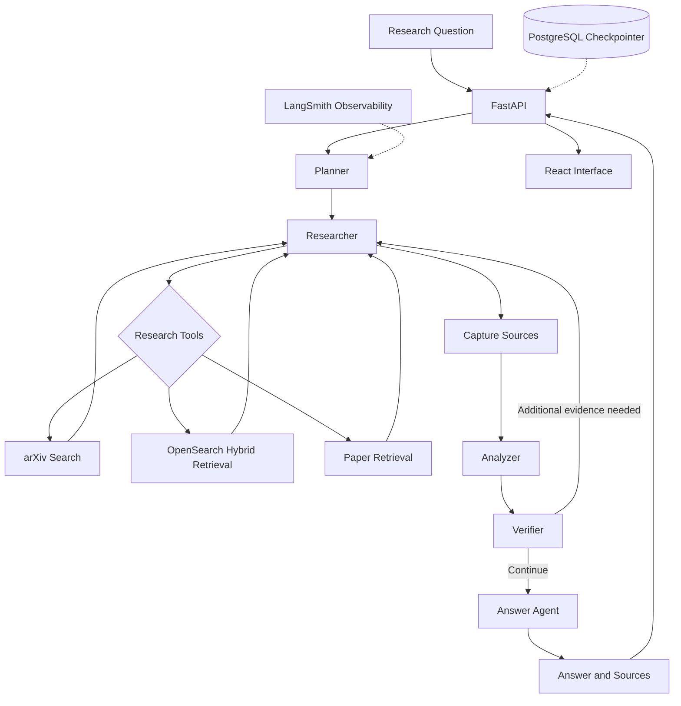

# Shod — AI Research Agent

**Research smarter. Discover papers. Build answers from evidence.**

Shod is an AI-powered research assistant that brings academic paper discovery, hybrid retrieval, evidence analysis, and verification into a unified research workflow.

Built with LangGraph, LangChain, OpenSearch, FastAPI, and React, Shod orchestrates multiple research stages to help users explore academic literature and generate answers grounded in retrieved evidence.

A Telegram-based interface is part of the upcoming Shod experience, bringing research assistance closer to where users communicate.

## Overview

Research often requires moving between academic search engines, papers, notes, and scattered sources. Shod aims to simplify this workflow by combining paper discovery with retrieval-augmented generation and evidence-aware agent orchestration.

With Shod, users can explore research questions through a workflow that plans the research, retrieves relevant evidence, analyzes findings, verifies support, and generates a response.

## Key Capabilities

- **Agentic research workflow:** Orchestrates planning, research, analysis, verification, and answer generation using LangGraph.
- **Academic paper discovery:** Searches arXiv for relevant research papers.
- **Hybrid retrieval:** Combines BM25 keyword search and semantic retrieval.
- **Reciprocal Rank Fusion:** Combines lexical and semantic result rankings.
- **Evidence-aware analysis:** Synthesizes retrieved passages into research findings.
- **Evidence verification:** Evaluates whether findings are supported by the available sources and can trigger additional research.
- **Structured source tracking:** Maintains paper metadata, source URLs, and retrieved evidence.
- **Persistent graph state:** Uses PostgreSQL-backed LangGraph checkpointing for conversation and workflow state.
- **Web interface:** React-based research workspace backed by a FastAPI application.
- **Local model support:** Supports Ollama for local inference, alongside integrations with other model providers.
- **Observability:** Integrates with LangSmith for inspecting agent execution and debugging workflows.

## Architecture



## How It Works

### 1. Research planning
The planner interprets the research question and creates a plan to guide evidence collection.

### 2. Research and retrieval
The researcher uses available tools to discover academic papers and retrieve relevant passages from the indexed research corpus.

### 3. Hybrid search
Shod combines two complementary retrieval approaches:

- **BM25:** Finds relevant documents through lexical matching.
- **Semantic search:** Retrieves conceptually related passages using vector embeddings.

Reciprocal Rank Fusion combines the rankings from these retrieval methods into a unified result set.

### 4. Source capture
Retrieved evidence is collected into structured source records containing paper titles, arXiv identifiers, URLs, and evidence passages.

### 5. Analysis and verification
The analyzer synthesizes the retrieved evidence. The verifier checks whether the findings are supported, identifies limitations, and assesses whether further research is needed.

The graph can route back to the researcher when additional evidence is required, subject to a bounded iteration limit.

### 6. Answer generation
The answer agent uses the research findings, source evidence, and verification feedback to produce a response.

## Technology Stack

| Component | Technology |
|---|---|
| Frontend | React, JavaScript, Vite |
| UI and styling | Tailwind CSS v4, shadcn/ui, Base UI, Lucide |
| API | FastAPI, Pydantic |
| Agent orchestration | LangGraph, LangChain |
| Paper discovery | arXiv API |
| Search engine | OpenSearch |
| Retrieval methods | BM25, semantic search, Reciprocal Rank Fusion |
| Embeddings | Hugging Face Sentence Transformers |
| Persistence | PostgreSQL, LangGraph checkpointing |
| Local inference | Ollama |
| Additional LLM providers | Gemini, Groq |
| Observability | LangSmith |
| Service management | Docker Compose |

## Project Structure

```text
Shod/
├── src/
│   └── researchagent/
│       ├── graph/          # Agent workflow and state
│       ├── tools/          # Research tools
│       ├── ingestion/      # Paper discovery and ingestion
│       ├── retrieval/      # Hybrid search and OpenSearch
│       ├── rag/             # LLM and RAG components
│       └── database/       # Database integrations
├── FastApi/
│   ├── main.py             # HTTP endpoints
│   ├── service.py          # Research graph integration
│   └── schemas.py          # API schemas
├── frontend/
│   └── src/                # React application
├── test/                   # Tests and development scripts
├── docker-compose.yml
├── pyproject.toml
├── uv.lock
└── README.md
```

## Getting Started

### Prerequisites

- Python 3.12
- [uv](https://docs.astral.sh/uv/)
- Node.js and npm
- Docker and Docker Compose
- [Ollama](https://ollama.com/)

### 1. Clone the repository

```bash
git clone <YOUR_REPOSITORY_URL>
cd Shod
```

### 2. Install backend dependencies

```bash
uv sync
```

### 3. Configure environment variables

Create a local `.env` file using `.env.example` as a reference.

Configure the variables required by your selected LLM provider, OpenSearch, PostgreSQL, and LangSmith if tracing is enabled.

Keep API keys and other secrets out of Git.

### 4. Start supporting services

```bash
docker compose up -d
```

Check the Compose configuration for the services and ports used by your local setup.

### 5. Start the local model

For the default Ollama configuration:

```bash
ollama pull llama3.2:3b
ollama list
```

Ensure the Ollama service is running before starting research requests.

### 6. Run the backend

From the repository root:

```bash
uv run uvicorn FastApi.main:app --reload
```

API documentation:

http://localhost:8000/docs

### 7. Run the frontend

Open a separate terminal:

```bash
cd frontend
npm install
npm run dev
```

Open the local URL printed by Vite, typically:

http://localhost:5173

Ensure the API CORS configuration allows your frontend origin.

## API Usage

### Research endpoint

`POST /research`

Example request:

```json
{
  "question": "How can retrieval-augmented generation reduce hallucinations in large language models?",
  "thread_id": null
}
```

The response includes the thread identifier, question, generated answer, retrieved sources, and verification output. Refer to `/docs` for the active request and response schemas.

## Design Decisions

### Why LangGraph?

Research is a multi-step process involving tool execution, conditional routing, state management, and bounded retries. LangGraph makes these transitions explicit and allows the workflow to be inspected and extended.

### Why hybrid retrieval?

Keyword search and semantic search solve complementary problems. BM25 is useful for exact terminology, while semantic retrieval helps identify passages with related meaning. RRF combines their rankings.

### Why a separate verifier?

Generating a plausible answer is not the same as verifying its supporting evidence. A separate verification stage makes evidence sufficiency and additional research explicit parts of the workflow.

### Why PostgreSQL and OpenSearch?

PostgreSQL supports durable workflow state and checkpointing, while OpenSearch supports indexing and retrieval over the research corpus. Each service has a distinct responsibility.

### Why support local inference?

Ollama allows development and experimentation with local models, reducing dependence on paid inference APIs for supported workflows.

## Roadmap

Shod is evolving toward a unified research workspace with:

- A conversational web research interface.
- Persistent main research threads and paper-specific conversations.
- Progressive answer streaming and research-status updates.
- Research evaluation and answer-quality measurement.
- Guardrails, reliability improvements, and deployment automation.
- A Telegram-based research assistant.
- Productivity integrations for research documents, spreadsheets, and email.

## Security

- Store API keys and credentials in environment variables or a secret manager.
- Keep `.env`, local model files, and private research data out of version control.
- Validate incoming API requests and handle dependency failures.
- Review access controls before exposing the API publicly.

## License

Choose and add a license file before distributing the project for reuse.

---

**Shod — turning research questions into evidence-backed exploration.**